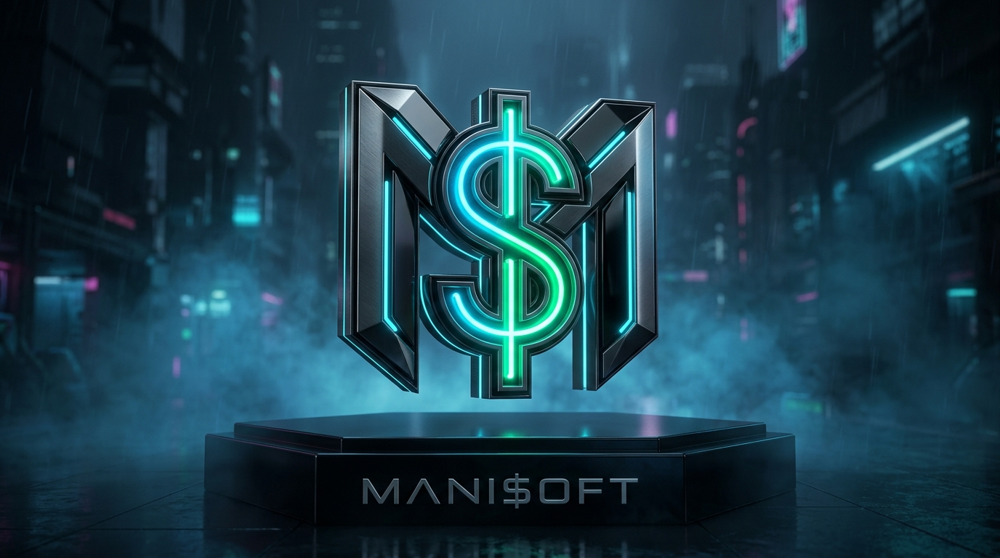
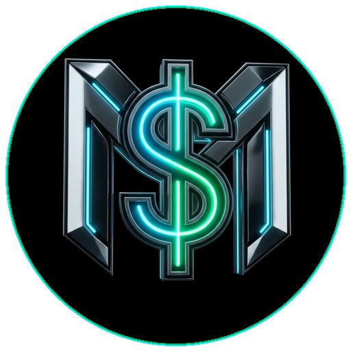

  <!-- World-Class Mani$oft Brand Logo -->
  

    

  <!-- Mani$oft Avatar Emblem -->
  

  <!-- Name & Title -->
  <h1>Manifest Subeno</h1>

  

    <strong>Founder &amp; Lead Architect @ Mani$oft</strong> 
    <em>Full-Stack Software Engineer &bull; Systems Architect &bull; Platform Innovator</em>
  

  <!-- Animated Typing SVG -->
  

    

  <!-- Quick Badges -->
  
  
  
  

---

### 👨‍💻 About Me &amp; Vision

> *"Great software isn't just written—it is engineered with surgical discipline, sovereign autonomy, and an obsessive pursuit of performance."*

I am **Manifest Subeno**, a **Full-Stack Software Engineer &amp; Platform Architect** and the driving force behind **Mani$oft**. I specialize in creating resilient, high-concurrency distributed platforms, zero-dependency real-time engines, cognitive telemetry suites, and autonomous developer tooling.

Whether engineering biomechanical keystroke-dynamics anti-cheat engines, building browser-native 3D tactical combat engines in WebGL, or architecting self-healing multi-service operational matrices, my work bridges raw computational velocity with human-centric, high-impact user experiences.

- 🚀 **Founder &amp; Architect @ Mani$oft**: Pioneering sovereign developer platforms, container hypervisors, and autonomous fleet orchestration.
- 🌟 **Creator of Lumina v5.2**: An innovative cognitive esports &amp; talent discovery engine transforming mental reflexes into cryptographically verified academic dossiers.
- 🎯 **Engineering Pillars**: Zero unnecessary dependencies, sub-millisecond execution velocity, strict defensive engineering, and cryptographic verification (`SHA256`).
- 🧠 **Specialized Domains**: Real-time WebSockets, biometrics &amp; keystroke entropy telemetry, Socratic AI coaching pipelines, WebGL shaders, and offline-first zero-cloud computing.
- 🌍 **Core Mission**: Democratizing high-performance software, unlocking untapped human potential through technology, and engineering tools that empower creators worldwide.

---

### 🛠️ Core Technology Stack

#### Languages &amp; Core Systems

  
  
  
  
  
  
  
  

#### Frameworks, Engines &amp; Real-Time Architecture

  
  
  
  
  
  
  

#### Databases, DevOps &amp; Cloud Infrastructure

  
  
  
  
  
  
  
  

---

### 🚀 Flagship Engineering Projects

| System | Architecture &amp; Capabilities | Primary Stack |
| :--- | :--- | :--- |
| 🌟 **Lumina v5.2** | **Cognitive Talent Discovery &amp; Competitive Esports Platform** • Real-time multiplayer arenas with WebSockets &amp; ELO matchmaking • Keystroke Dynamics Anti-Cheat (biomechanical flight time &amp; entropy analysis) • 3-Leg Cooperative Relay (Arithmetic &rarr; Pattern Logic &rarr; Speed Typing) • Institutional dossiers with SHA256 cryptographic verification &amp; zero-cloud offline hub | `Python` `Flask` `WebSockets` `Web Audio API` `SQLite` |
| 🛡️ **ManiSoft Mission Control** | **Sovereign Developer Hypervisor &amp; Fleet Orchestrator** • Developer mission control with live threat intelligence radar • Unified container hypervisor, database studio, and automated API test suites • Autonomous multi-project fleet publishing engine &amp; self-healing verification | `Python` `Flask` `Docker` `Shell` `Security Auditing` |
| 🎯 **PassMaster AI** | **Socratic AI Exam Mastery &amp; Diagnostic Engine** • Socratic error analysis detecting underlying cognitive traps • Leaky-bucket micro-topic diagnostics pinpointing specific mark deficits • Adaptive question pacing tailored for high-stakes academic success | `Python` `Generative AI` `REST APIs` `Analytics` |
| 🕹️ **Strike Ops** | **Browser-Native 3D Tactical Combat Engine** • High-performance first-person shooter running natively in the browser • Zero external runtime dependencies or heavy client installations • Custom particle systems, raycast ballistic physics, and procedural Web Audio | `JavaScript` `WebGL` `Three.js` `Web Audio API` |
| ⚡ **Aether Transport** | **High-Performance Transport &amp; Logistics Engine** • Concurrent logistics processing and route scheduling system • Memory-safe zero-overhead architecture containerized for microservices | `Rust` `Cargo` `Docker` `Microservices` |
| 💎 **Starshine Steez** | **Haute Horology &amp; Designer E-Commerce Platform** • Obsidian &amp; Champagne Gold luxury UX with glassmorphic aesthetics • 1-click WhatsApp instant order fulfillment system | `HTML5` `CSS3` `JavaScript` `Responsive UI` |

---

### 📈 GitHub Telemetry &amp; Activity

  <!-- Streak Stats -->
  

---

### 🤝 Connect &amp; Collaborate

  
I am always open to discussing platform architectures, distributed systems, open-source initiatives, or high-scale engineering collaborations.

  
  &nbsp;
  

    

  <!-- Footer Banner -->
  

